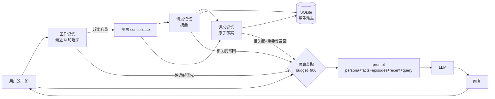

# Companion-AI Memory · Context Token Optimization

**用「人脑记忆的可观察规律」管理 LLM 上下文：省 token，同时不失忆。**

> 大多数「上下文压缩」是**回顾式**的：先塞进窗口，等撑爆了再把旧消息摘要掉 —— 压缩发生在**已经被烧掉的 token 之后**。
> 本项目是**预算式**的：给每类记忆分配额度，装配时按额度取用；原文从不长期驻留，事实与情景摘要才是记忆的载体。

```
对话全文塞窗口        →  上下文暴涨、越聊越贵、超窗后被粗暴截断 → 失忆
滑动窗口              → 便宜，但 8 轮之外的一切都不存在 → 失忆
caim（本项目）        → 逐字原文只在工作记忆里活几轮，事实/摘要长期驻留 → 省 80% token 且 4/4 召回
```

---

## 快速开始

```bash
pip install -e .            # 或 pip install -r requirements.txt
python examples/demo.py     # 三种策略的成本 / 召回对比
pytest -q                   # 15 个用例
```

```python
from caim import CompanionMemory, RuleLLM

mem = CompanionMemory("chat.db", context_budget=900, working_capacity=6)

bundle = mem.build_context("我想吃点点心，有什么要注意的吗")
print(bundle.tokens, bundle.sections)     # 每段花了多少 token，一目了然
print(bundle.text)                        # 直接拼进 prompt

answer = RuleLLM().answer(bundle.text, "我想吃点点心，有什么要注意的吗")

mem.add_turn("我想吃点点心，有什么要注意的吗", answer)
```

真实 LLM 接入只需两步：把 `bundle.text` 拼进 system prompt；把模型回复传给 `add_turn`。

---

## 实测结果（`python examples/demo.py`）

一次性写入 70 轮对话，其中 4 条是关键事实（名字 / 过敏源 / 猫名 / 城市），其余 66 轮是闲聊干扰。写完后问 4 个只有靠长期记忆才能答对的问题：

| 策略 | 每轮上下文 tokens | 70 轮累计 tokens | 召回 |
|---|---:|---:|---:|
| full（全量历史） | 1,302 | 91,140 | 3/4 |
| window（最近 8 轮） | 142 | 9,940 | **0/4** |
| **caim（三层记忆）** | **247** | **17,290** | **4/4** |

- 相对「全量历史」**省 81% token**，召回反而更高（全量历史里 3/4，因为无关内容稀释了注意力）
- 对「滑动窗口」：贵 74%，但**召回从 0 变成 4** —— 窗口外的事实一条都留不住

> 评测用的是自带的 `RuleLLM`（只在上文里做字符匹配、找不到就说「不知道」）。
> 这是刻意的：用真模型打分，「答对」可能来自模型常识，就测不出**上下文里到底有没有这条信息**。

---

## 三个可观察的记忆现象 → 三行代码

| 人脑现象 | 本项目的对应 | 代码 |
|---|---|---|
| **遗忘曲线**：不复习就衰减 | 保留强度 `R = exp(-ln2·Δt/S)`，S 为半衰期 | `activation.retention` |
| **稳定度差异**：越重要/越常提的记忆衰减越慢 | `S = 6h × (1+0.5·access) × (1+2·importance)` | `activation.stability_hours` |
| **复述加固**：回忆一次就记得更牢 | 每次被召回 `access_count += 1`，半衰期变长 | `store.touch` |
| **睡眠巩固**：短期记忆转长期 | 工作记忆溢出 → 压成情景摘要 → 抽事实入库 | `memory.consolidate` |
| **工作记忆容量有限**（7±2 组块） | 最近若干轮逐字原文，超出即巩固并丢弃原文 | `deque(maxlen=working_capacity)` |
| **线索驱动检索**：闻到味道想起往事 | 相关度主导的激活度打分 | `activation.activation` |

```python
# 半衰期：越重要、被回忆越多，衰减越慢
S = 6.0 * (1 + 0.5 * access_count) * (1 + 2 * importance)   # 小时
R = exp(-ln2 * (now - last_access) / S)                     # 0~1，遗忘曲线

# 激活度：相关度必须占主导，不能因为「很新很重要」就注入无关内容
score = 0.55 * relevance + 0.30 * importance + 0.15 * retention
```

---

## 架构



**装配顺序即优先级**：`persona` → `facts`（相关召回 + 高重要性常驻）→ `episodes`（相关往事）→ `recent`（从最近往回装）→ `query`（永不丢）。
任何一段装不进预算就记进 `dropped` 并跳过 —— **不是删除存储，只是这次不注入**。

```text
【设定】你是用户的长期陪伴助手，记得你们之前聊过的事情。

【关于用户的事实】
- 用户对花生过敏，上次差点进医院
- 用户的名字叫林晚，在杭州做后端开发
- 用户养了只猫叫豆豆，是只橘猫

【往事回顾】
- 用户提过周三晚上有日语课

【最近对话】
用户：我想吃点点心
助手：注意别碰花生的

【当前输入】
用户：有什么推荐的
```

---

## 为什么这样省 token

1. **原文不驻留**：逐字对话只活在工作记忆里，几轮后压成 1 条摘要，token 增长从线性变对数
2. **召回才付费**：无关的事实/摘要不进上下文，闲聊 66 轮几乎不产生成本
3. **摘要本身有预算**：`ExtractiveSummarizer.summarize(max_tokens=120)` 硬截断，单句不会冲破预算
4. **估算器可换**：`token_counter=` 注入真实 tokenizer；默认估算器零依赖、单调、稳定

## 为什么这样不失忆

1. **事实原子化 + 主语归一**：「我叫林晚」→ `用户的名字叫林晚`，检索层和存储层对齐，避免「我/用户」错位导致召回失败
2. **去重合并**：相似度 ≥0.9 的事实只加固不重复存，防止同一件事被反复记成多条
3. **相关度过滤**：往事回顾只有在相关度 ≥0.08 时才占额度，避免「摘要噪音」把事实挤出去
4. **当前输入永不丢**：预算再紧，`query` 也一定在上下文里（有专门用例覆盖）

---

## API

| 方法 | 作用 |
|---|---|
| `CompanionMemory(db_path, context_budget, working_capacity, summarizer, token_counter)` | 创建（`":memory:"` 不落盘） |
| `.add_turn(user, assistant)` | 记一轮；内部自动抽事实、必要时巩固 |
| `.build_context(query, budget=None) -> ContextBundle` | 装配上下文（`.text` / `.tokens` / `.sections` / `.dropped`） |
| `.recall(query, k)` | 按激活度召回记忆 |
| `.consolidate(turns)` | 手动触发巩固（比如睡前批量处理） |
| `.stats()` | 事实数 / 摘要数 / 工作记忆占用 |

扩展点：`Summarizer` 协议（接 LLM 摘要）、`token_counter`（接 tiktoken）、`MemoryStore`（换向量库）。

## 目录

```
src/caim/
  models.py      # MemoryItem / ContextBundle
  tokens.py      # 零依赖 token 估算
  store.py       # SQLite 持久化（幂等、事实去重）
  activation.py  # 遗忘曲线 / 稳定度 / 激活度
  retrieval.py   # 字符 n-gram 相关度（中文友好）
  compress.py    # 抽取式摘要 + 事实抽取（Summarizer 协议）
  context.py     # 预算化装配（本项目的核心）
  memory.py      # 门面
examples/demo.py # 三策略成本/召回对比
tests/           # 15 个用例：预算、遗忘、巩固、去重、安全边界
```

## 已知局限（别当黑盒用）

- **事实抽取是启发式的**（线索词 + 主语归一），会漏也会误收；生产环境请把 `Summarizer` 换成 LLM 抽取，接口已留好
- **相关度是字符 n-gram**，不做同义/语义匹配（「过敏」≈「不能吃」匹配不上）；换 embedding 只需替换 `retrieval.relevance`
- 估算 token 数与真实 tokenizer 有 ±10% 偏差，预算控制是「软上限」
- 单机 SQLite，多进程并发写需自行加锁

## 路线图

- [ ] `EmbeddingRetriever`：可插拔的向量检索
- [ ] `LLMSummarizer`：用模型做巩固（保留可追溯到原始轮次的指针）
- [ ] 遗忘阈值自动清理（长期未召回 + 低重要性 → 归档而非删除）
- [ ] 与 LangChain / LlamaIndex 的 Memory 适配器

## License

MIT
